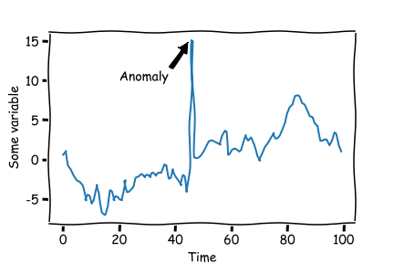

Getting started
===============



Sensors often provide faulty or missing observations. These anomalies must be detected automatically and replaced with more feasible values before feeding the data to numerical simulation engines as boundary conditions or real time decision systems.

This package aims to provide examples and algorithms for detecting anomalies in time series data specifically tailored to DHI users and the water domain. It is simple to install and deploy operationally and is accessible to everyone (open-source).

`tsod` is a library for time series data. The supported input formats are [](`pandas.Series`) and [](`pandas.DataFrame`) (single or multicolumn), and the output type always matches the input type.

1. Get data in the form of a a [](`pandas.Series`) or [](`pandas.DataFrame`). 
2. Select one or more detectors e.g. [](`~tsod.RangeDetector`) or [](`~tsod.ConstantValueDetector`)
3. Define parameters (e.g. min/max, max rate of change) or...
4. Fit parameters based on normal data, i.e. without outliers
5. Detect outliers in any dataset

Example
-------

```{python}
import pandas as pd
from tsod import RangeDetector
rd = RangeDetector(max_value=2.0)
data = pd.Series([0.0, 1.0, 3.0]) # 3.0 is out of range i.e. an anomaly
anom = rd.detect(data)
anom
```

```{python}
data[anom] # get anomalous data
```

```{python}
data[~anom]  # get normal data
```


Missing values
--------------
Every detector takes a `nans` argument that sets how NaN values are handled:

- `nans="omit"` (default): warn, drop the NaN rows and run on each slice of consecutive data between them, so values on either side of a NaN are never compared. The dropped rows are `False` in the output, which keeps the input index. In a DataFrame, each column is handled on its own.
- `nans="raise"`: raise `NaNInDataError`.

```python
from tsod import DiffDetector
DiffDetector(max_diff=1.0, nans="raise")
```

`CombinedDetector` leaves NaN handling to the detectors it combines.


Saving and loading
------------------
Save a configured detector
```python
cd = CombinedDetector([ConstantValueDetector(), RangeDetector()])
cd.fit(normal_data)
cd.save("detector.joblib")
```

... and then later load it from disk
```python
my_detector = tsod.load("detector.joblib")
my_detector.detect(some_data)
```
    